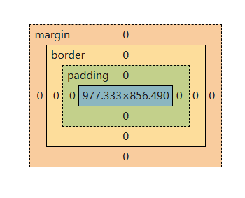

# 10/22
| 标签	| 放什么 |	规则 |
| ----- | :---: | :---: |
| header	| 页头（logo + 站名）；也可以是一个文章的头	| 可以出现多次 |
| nav	| 一组导航链接	| 里面用 ul > li > a，不要直接堆 a |
|main	|页面主体内容	|一个页面只能有一个|
|article	|一篇能独立成立的内容（一篇博客、一条动态）	|里面可以有自己的 header / footer|
|section	|主题相同的一组内容，通常带小标题	|别用它代替 div，没有主题就别用|
|aside	|和主体相关但可以拿掉的内容（侧栏、标签云、推荐）	|拿掉后主体仍然完整|
|footer	|页脚（版权、备案、友情链接）	|可以出现多次|

# 10/23
### css结构
```
// 1. 地基
*, *::before, *::after {
  box-sizing: border-box;
}

// 2. 设计 token
:root {
  --color-bg: #ffffff;
  ...
}

// 3. 重置浏览器默认样式
body, h1, h2, p, ul { margin: 0; padding: 0; }
ul { list-style: none; }
a { color: inherit; text-decoration: none; }

// 4. 全局
body {
  background-color: var(--color-bg);
  color: var(--color-text);
  font-family: ...;
}

// 5. 组件
.site-header { ... }
.nav-list { ... } // flex
.site-footer { ... }
```
### flex
给容器设 display: flex 之后，只有它的直接子元素受影响，孙子辈不管。所以 .nav-list 是 ul，排成一行的是 li。
最常用的三个属性：
|属性	 |作用 |	常用值|
| :---: | :---: | :------: |
|justify-content	|孩子沿主轴怎么排（横排时就是左右）	|flex-start （靠左对齐） / center / space-between （两端对齐）|
|align-items	|孩子沿交叉轴怎么对齐（横排时就是上下）	|flex-start / center / stretch|
|gap	|孩子之间的空隙|	8px / 16px|

`flex-wrap: wrap;` 自动换行，默认不换行

`flex-direction: column;` 竖排

`flex-direction: row;` 横排默认



# 10/24
### Grid 和 Flex 有什么区别
- Flex：管一行（或一列）里的东西怎么排。适合导航栏、工具栏。
- Grid：管行和列，二维的。适合卡片列表、相册、仪表盘。
  
**`fr` 是什么**：fraction（份）。`1fr` 是「一份」，`repeat(2, 1fr)` 是「两份平分」。它不是固定像素，会跟着容器宽度自动伸缩——这就是 `Grid` 能自适应宽度、而写死 `px` 不行的原因。
### 媒体查询
```
@media (min-width: 768px) {
  /* 屏幕宽度 >= 768px 时，这里面的规则才生效 */
  .post-list {
    grid-template-columns: repeat(2, 1fr);
  }
}
```
媒体查询里的规则不会替换外面的规则，是覆盖。

@media 里的 .post-list 和外面的 .post-list，特异性完全一样（都是 0,1,0）。​
**特异性一样时，规则就是后写的赢。**

# 10/25
`const` 常量 `let` 变量

`node.js` 简称 `node` 是 `js` 的运行环境

`ts` 是 `js` 加类型

### js语法初步
- **对象数组 前端最常用的数据结构**
```
const posts = [
  {
    id: 1,
    title: "为什么我决定认真学前端",
    date: "2026-10-21",
    summary: "从零基础到能做出一个能访问的网站，这篇记录一下起点。",
    tags: ["随笔"]
  },
  {
    id: 2,
    title: "盒模型：为什么我的元素比写的宽",
    date: "2026-10-22",
    summary: "写 width: 200px 结果占了 244px？content-box 和 border-box 的区别。",
    tags: ["CSS"]
  }S"
];
```
- **反引号**

\`你好，${name}` //\${} 里可以放任何表达式，结果拼进字符串

\`第一行

第二行`                     // 可以直接换行

- **data-\* 自定义属性**

```
<button class="filter-btn" data-tag="CSS">CSS</button>//整个是标签
  ↑        ↑                    ↑          ↑    ↑
标签名   属性1                属性2       内容  闭标签
```
|HTML 里写的	|JS 里读的	|得到|
|:----------:|:--------:|:---:|
|data-tag="CSS"	|btn.dataset.tag	|"CSS"|
|data-post-id="3"	|el.dataset.postId	|"3"|

- **querySelectorAll(".filter-btn") 找元素**

- **=== 是「严格相等」**

### 事件监听
`addEventListener("click", ...)` 注册监听：这个按钮被点了，就执行后面的函数

filter 和 map 都是遍历数组，但是：
- map：每项都处理，数量不变（6 进 6 出）
- filter (过滤)：每项都判断，只留返回 true 的（6 进 3 出）

筛选不是把不匹配的卡片藏起来，而是「拿到新数据 → 清空容器 → 重新生成」。

### DOM
浏览器把 HTML 解析成一棵树，叫 DOM。
```
document // 全局对象，代表当前这个页面
└─ html
   └─ body
      ├─ header
      ├─ main
      │  └─ div.post-list
      │     ├─ article.post-card   ← 第 1 张卡片
      │     ├─ article.post-card   ← 第 2 张
      │     └─ article.post-card   ← 第 3 张
      └─ footer
```
# 10/26
### classList
`class="filter-btn is-open"` 一个字符串，多个 `class` 用空格隔开

`filter-btn`   `is-open`    **classList**：拆成两个独立的 `class`

JS 只负责切 class，长什么样全在 CSS 里。
>状态和表现分离

|方法	|作用	|例子|
|:---:|:--:|:---:|
|add("x")	|加一个 class|	el.classList.add("is-open")|
|remove("x")	|删一个 class|	el.classList.remove("is-open")|
|toggle("x")	|有就删，没有就加	|el.classList.toggle("is-open")|
|contains("x")	|有没有，返回 true/false	|el.classList.contains("is-open")|
```
const el = document.querySelector(".nav-list");   // ① el 现在指向那个 ul
el.classList.add("is-open");                       // ② 给这个 ul 加 class
```
# 10/27
数据和渲染分开。
- data.js —— 只管数据
- main.js —— 首页的渲染和筛选
- post.js —— 详情页的渲染

find 和 filter 的区别：
- filter 返回数组（可能有 0 个、1 个、多个）
- find 返回第一个匹配的元素本身（或 undefined）
要「一篇文章」用 find，要「一批文章」用 filter。

### localStorage
浏览器给你的一块永久存储区，关掉浏览器、重启电脑，数据还在，只能存字符串。
```
localStorage.setItem("theme", "dark");   // 存
localStorage.getItem("theme");           // 读，返回 "dark"；没有则返回 null
localStorage.removeItem("theme");        // 删
```

存对象要转换
```
// 存：对象 → 字符串
localStorage.setItem("user", JSON.stringify({ name: "Windsky" }));
// 存进去的是 '{"name":"Windsky"}'

// 读：字符串 → 对象
const user = JSON.parse(localStorage.getItem("user"));
// { name: "Windsky" }
```
|方法	|方向|	记住方式|
|:---:|:--:|:-------:|
|JSON.stringify	|对象 → 字符串	|stringify = 变成 string|
|JSON.parse	|字符串 → 对象	|parse = 解析|

# 10/28
`root.setAttribute("data-theme", "dark")`	给 `<html>` 加属性 → CSS 里 [data-theme="dark"] 生效

`root.removeAttribute("data-theme")`	删掉属性 → 回到默认的浅色

FOUC（Flash of Unstyled Content，无样式内容闪烁）

### 一、transition 只能过渡「有中间值」的属性
- 能过渡

transition: color 0.3s; 颜色

transition: opacity 0.3s; 透明度

transition: transform 0.3s; 

transition: width 0.3s; 尺寸

- 不能过渡

transition: display 0.3s; 没有中间状态，none 和 block 之间没有「半显示」这回事

```
transition: color 0.3s ease 0.1s;
/*          ↑     ↑    ↑     ↑
          属性  时长  曲线  延迟 */
//ease 是默认值（先快后慢），linear 是匀速
```
### @keyframes
transition 只能做「A 变到 B」。@keyframes 能做多段、自动播放、循环。

```
@keyframes fadeInUp {
  from {
    opacity: 0;
    transform: translateY(12px);
  }
  to {
    opacity: 1;
    transform: translateY(0);
  }
}
@keyframes 名字 { ... } 定义一个动画序列。from / to 也可以用百分比（0% / 50% / 100%），做多段动画时用百分比。

定义本身不会播放，得挂到元素上：
.post-card {
  animation: fadeInUp 0.4s ease-out both;
}

animation: fadeInUp 0.4s ease-out 0s both;
/*          ↑        ↑    ↑       ↑   ↑
           名字    时长  曲线   延迟 填充模式(动画开始前用 from 的样式，结束后保持 to 的样式) */
```
